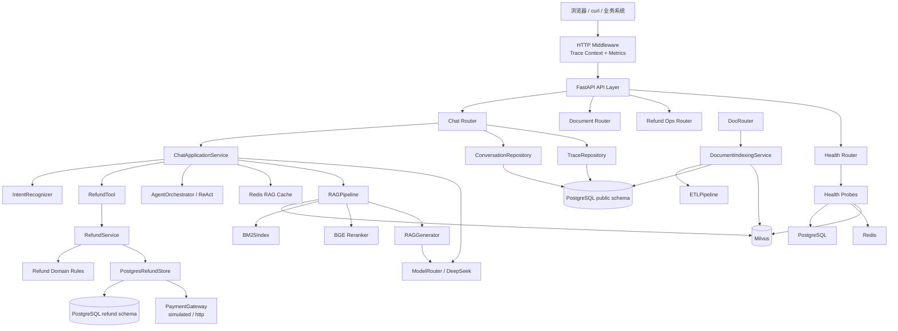

# 企业客服 Agent · 架构与功能说明

> 适用范围：当前 `main` 分支  
> 阅读对象：开发者、面试官、测试与运维人员  
> 定位：说明系统边界、分层架构、核心链路、数据模型、可观测性、测试与评测现状。

---

## 1. 项目一句话概述

这是一个可本地运行、可容器化部署的**企业客服 Agent 服务**，基于 FastAPI 构建单进程服务，当前包含两条核心能力：

1. **知识库问答 / RAG**：文档上传与目录同步 → ETL 分块 → Milvus 向量检索 + BM25 关键词检索 → RRF 融合 → 可选重排 → DeepSeek 生成带引用回答。
2. **自动化退款处理**：对话中识别退款动作后，直接进入确定性退款工具，完成准入校验、风控规则、动作分发、状态机流转、退款台账、人工任务转交和审计。

项目的设计原则是：

- **对话入口统一**：客服问答、政策咨询、退款申请都在 `/chat` 或 `/chat/stream` 完成。
- **资金动作确定性**：退款金额、状态、动作不交给 LLM 推理。
- **工具化扩展**：退款是第一个 Agent 工具，后续业务工具可复用 `ToolRegistry`。
- **生产可观测**：日志、指标、Trace、健康检查、依赖矩阵均已接入。
- **明确边界**：当前支付网关是模拟/HTTP 适配边界，尚未接真实渠道回调与对账。

---

## 2. 技术栈总览

| 层级 | 技术 | 作用 |
|---|---|---|
| Web 框架 | FastAPI + Uvicorn | HTTP/SSE 接口、路由、依赖注入 |
| 配置 | Pydantic Settings | 环境变量、类型化配置 |
| LLM | OpenAI 兼容 SDK / DeepSeek | RAG 生成、普通对话、任务 Agent |
| 嵌入 / 重排 | sentence-transformers，默认 BGE | 文本向量化与检索重排 |
| 向量库 | Milvus | 知识分块向量存储与检索 |
| 关键词检索 | 自研 BM25 | 中文 bigram 检索，混合检索一路 |
| 分块 | tiktoken | 递归分块 |
| 关系库 | PostgreSQL + SQLAlchemy + asyncpg | 会话、文档、Trace、公共 schema |
| 退款存储 | PostgreSQL + psycopg2 | 退款 schema、状态机、台账、任务 |
| 迁移 | Alembic | public schema 迁移；refund schema 使用 SQL 初始化 |
| 缓存 | Redis | RAG 精确结果缓存 |
| 日志 | Loguru | 控制台 / JSON 日志 |
| 指标 | Prometheus Client | HTTP、chat、RAG cache、工具、依赖错误指标 |
| 追踪 | 自研 Tracer + TraceLog | trace_id / span / duration 持久化 |
| 鉴权 | FastAPI API Key 依赖 | `X-API-Key` |
| 容器 | Docker Compose | app、PostgreSQL、Redis、Milvus、etcd、MinIO |
| 测试 | Pytest、pytest-asyncio | 单元、集成、架构守卫 |

---

## 3. 高层架构图



---

## 4. 代码分层与职责

### 4.1 目录结构概览

```text
app/
├── api/routes/
│   ├── chat.py             # /chat、/chat/stream
│   ├── document.py         # 文档上传、列表、知识库同步
│   ├── health.py           # /health、/ready、/metrics、/version
│   ├── refund_ops.py       # 退款运营接口
│   └── web.py              # HTML 页面与离线文档路由
│
├── core/
│   ├── chat/service.py     # 对话应用服务，核心编排层
│   ├── intent/             # 意图识别与语义兜底
│   ├── agent/              # ReAct Orchestrator
│   ├── tools/              # Agent 工具注册中心与退款工具
│   ├── rag/                # RAG 检索、索引、重排、生成
│   └── memory/             # 已删除；当前仅保留数据库只读会话记忆
│
├── domain/refund/          # 纯退款领域规则，不依赖 HTTP/DB/LLM
├── etl/                    # 文档解析、分块、ETL 流水线
├── infrastructure/         # LLM、Milvus、DB、Redis、观测、安全
├── models/                 # Pydantic 请求响应模型
├── shared/                 # 跨层纯函数工具集
├── config.py               # 全局配置
├── main.py                 # FastAPI 入口与 lifespan
└── cli.py                  # serve/init-db/sync/doctor/check/ask/documents
```

### 4.2 API 层

| 文件 | 职责 | 不应包含 |
|---|---|---|
| `api/routes/chat.py` | `/chat`、`/chat/stream` 的协议转换 | 业务规则、缓存细节 |
| `api/routes/document.py` | 文档上传校验、同步入口、列表 | ETL 实现细节 |
| `api/routes/health.py` | 存活、就绪、指标、版本 | 复杂业务诊断 |
| `api/routes/refund_ops.py` | 退款运营后台与 API | 风控规则本体 |
| `api/routes/web.py` | HTML 页面与离线文档 | 后端业务逻辑 |

### 4.3 应用服务层

`app/core/chat/service.py` 中的 `ChatApplicationService` 是当前对话主链路的编排层。

它负责：

1. 规范化 `conversation_id`；
2. 绑定 trace 上下文；
3. 调用意图识别；
4. 判断是否进入退款工具；
5. 判断任务意图是否进入 Orchestrator；
6. 查询 RAG 精确缓存；
7. 调用 RAG Pipeline；
8. RAG 未命中或失败时回退普通 LLM；
9. 持久化会话与 Trace；
10. 输出统一 `ChatResponse`。

它不负责：

- 退款规则计算；
- SQL 具体实现；
- Milvus 查询实现；
- LLM SDK 细节。

### 4.4 共享工具层

`app/shared/` 只放纯函数、常量与轻量类型，禁止依赖 FastAPI、SQLAlchemy、Redis、Milvus、OpenAI。

| 模块 | 能力 |
|---|---|
| `jsonx.py` | JSON 序列化与容错解析 |
| `hashing.py` | SHA-256、UUIDv4、UUIDv5 |
| `times.py` | UTC 时间、保留期截止点、诊断时间 |
| `files.py` | 文件名清理与上传类型白名单 |
| `http.py` | SSE 帧编码 |

`tests/test_architecture.py` 会守卫这些边界，防止共享层被基础设施依赖污染。

---

## 5. 核心功能链路

### 5.1 非流式对话链路 `/chat`

```text
POST /api/v1/chat
→ HTTP Middleware
  → 生成或继承 trace_id
  → 绑定 trace_id / conversation_id
→ Chat Router
→ ChatApplicationService.run_chat()
→ IntentRecognizer.recognize()
→ 分支判断

分支 1：退款动作
  → ChatApplicationService.try_refund()
  → ToolRegistry.get_tool("refund")
  → RefundTool.execute()
  → AgentService.submit()
  → RefundService
  → eligibility → risk → dispatch → nodes
  → PostgreSQL refund schema
  → RefundToolResult
  → ChatResponse

分支 2：任务类意图
  → AgentOrchestrator
  → ReActAgent
  → ToolRegistry（排除 refund）
  → OrchestrationResult
  → ChatResponse

分支 3：政策 / 知识问答
  → 生成 RAG cache key
  → Redis get()
  → 命中：直接返回 cache_hit=true
  → 未命中：RAGPipeline.retrieve()
     → vector search
     → keyword BM25
     → RRF fuse
     → optional rerank
  → RAGPipeline.answer()
  → RAGGenerator.generate()
  → DeepSeek 生成带引用回答
  → Redis set()
  → ChatResponse

分支 4：RAG 未命中或失败
  → ModelRouter.chat()
  → CircuitBreaker
  → DeepSeek
  → ChatResponse
```

关键行为：

- 退款意图优先于 RAG 和 LLM。
- “退货政策是什么”这类政策问法不会触发退款动作，而是进入 RAG。
- 退款工具不进入通用 Orchestrator 工具列表，避免资金动作被模型自主调用。
- RAG 只做结果缓存，退款结果永远不缓存。
- LLM 失败时返回 503；Redis / DB 持久化失败通常只记录 warning，不阻断聊天。

---

### 5.2 流式对话链路 `/chat/stream`

`/chat/stream` 使用 SSE 风格响应。

流程：

1. 生成 `trace_id` 和 `conversation_id`。
2. 持久化 Trace。
3. 识别意图。
4. 如果命中退款，直接返回完整退款结果帧和 `done` 帧。
5. 如果是 RAG 命中，返回完整回答和引用。
6. 如果是普通 LLM，调用 DeepSeek stream，逐 delta 发送 `content`。
7. 最后发送 `done: true`。

SSE 帧格式：

```json
{"content": "...", "trace_id": "..."}
```

结束帧：

```json
{"done": true}
```

注意：当前退款和 RAG 分支不是逐 token 流式输出，而是组装后单帧返回；普通 LLM 分支支持逐 delta 输出。

---

### 5.3 意图识别

`app/core/intent/recognizer.py` 负责第一层规则识别。

能力包括：

- 识别问答 / 售后 / 任务等意图；
- 识别子意图，例如政策咨询、退款、退货；
- 抽取 `order_id`、`refund_id` 等槽位；
- 使用 `is_refund_action()` 判断是否是退款动作，而不是退款政策咨询；
- 输出 `IntentResult`，包含 intent、confidence、slots、sub_intent。

`app/core/intent/semantic.py` 提供语义兜底：

- 当规则置信度不足时，可使用 BGE embedding 做近邻意图识别；
- 作为规则识别的兜底层，不替代退款动作的确定性判断。

---

### 5.4 RAG 知识库链路

#### 入库链路

有两个入口：

1. `POST /api/v1/documents/upload`
2. `POST /api/v1/documents/sync-knowledge`

两个入口统一走 `app/core/rag/indexing.py` 的 `DocumentIndexingService`。

流程：

```text
文件 / bytes
→ DocumentParser 解析 TXT / PDF / 纯文本
→ DocumentChunker 递归分块
→ 生成稳定 doc_id / chunk_id
→ PostgreSQL documents / document_chunks 落库
→ Milvus 向量写入
→ 更新 indexed_chunks / vector_id
→ BM25 索引失效
→ 下次查询重建 BM25
```

失败策略：

- 向量库失败时，文本仍可落库，`indexed_chunks=0`，后续同步可回填；
- PostgreSQL commit 失败时，回滚并尝试删除已写入向量；
- 知识库目录同步使用进程内 asyncio lock + PostgreSQL advisory lock，避免多副本重复同步。

#### 检索链路

`RAGPipeline.retrieve()` 支持三种模式：

| 模式 | 行为 |
|---|---|
| `vector` | 仅 Milvus 向量检索 |
| `keyword` | 仅 BM25 |
| `hybrid` | 向量 + BM25，然后 RRF 融合 |

流程：

```text
query
→ embedding
→ Milvus search
→ BM25Index.search
→ RRF 融合
→ 可选 BGE Reranker
→ top_k 结果
```

`RAGPipeline.answer()` 会把检索结果格式化为带编号上下文，交给 `RAGGenerator`。

`RAGGenerator` 做：

1. 组装 system prompt；
2. 组装历史对话与上下文；
3. 调用 DeepSeek；
4. 解析 `[1]`、`[2]` 等引用；
5. 返回 `RAGResponse`，包含 answer、citations、model。

---

### 5.5 退款自动化链路

退款是本项目最重要的确定性业务链路。

#### 对外入口

1. `/chat`：自然语言识别退款意图。
2. `/chat/stream`：流式对话中的退款分支。
3. `POST /api/v1/refunds`：运营后台 / 测试接口直接提交订单快照。

#### 领域模型

退款域当前覆盖：

- 36 字段订单契约；
- 20 条风控规则；
- 15 类处理动作；
- 13 个工作流状态；
- 独立 PostgreSQL `refund` schema；
- 幂等键、台账、人工任务、审计日志。

#### 业务流程

```text
AgentRequest
→ AgentService
→ RefundService.submit_record()
→ eligibility 准入校验
→ risk 风控规则评估
→ dispatch 动作分发
→ nodes 节点执行
→ PostgreSQL 状态机 / 台账 / 任务
→ CaseView
→ AgentResponse
```

#### 典型动作

| 动作 | 结果 |
|---|---|
| `AUTO_APPROVE_AND_REFUND` | 自动通过并发起退款，状态最终 `closed`，台账 `consumed` |
| `AUTO_APPROVE_NO_RETURN` | 免退货自动通过 |
| `PARTIAL_REFUND_FREIGHT_ONLY` | 仅退运费 |
| `HOLD_UNTIL_RETURN_RECEIVED` | 挂起等待退货入库 |
| `REJECT_AMOUNT_EXCEEDED` | 超额拒绝 |
| `REJECT_ALREADY_REFUNDED` | 已退款拒绝 |
| `REJECT_ORDER_NOT_REFUNDABLE` | 订单不可退拒绝 |
| `MANUAL_REVIEW_AND_RECON` | 人工审核 + 对账 |
| `MANUAL_APPROVAL` | 人工审批 |
| `RISK_HOLD_FOR_REVIEW` | 风控冻结 |
| `ADJUST_TAX_EXCLUDED` | 调整税费金额 |
| `DISPUTE_EVIDENCE_FLOW` | 转纠纷举证 |
| `QUERY_THEN_RECONCILE` | 先查询再对账 |
| `DEDUPE_RETURN_EXISTING` | 幂等返回原售后单 |
| `RISK_REJECT` | 风控拒绝 |

#### 幂等与台账

- `refund_requests` 保存原始请求快照和处理状态；
- `return_orders` 是售后单状态机；
- `refund_ledger` 使用 `return_id:refund` 幂等键；
- `refund.audit_log` 记录状态流转；
- `review_tasks` 保存人工审核、举证、争议任务；
- `refund.kv` 保存售后单号序列。

#### 支付网关

`PaymentGateway` 是端口：

- `SimulatedPaymentGateway`：本地演示，只验证语义，不产生真实资金；
- `HttpPaymentGateway`：通用 HTTP 适配边界，可配置 URL / Token / timeout。

生产接入真实渠道时，还需要补齐：

- 回调通知；
- 回调验签；
- 渠道单号；
- 对账任务；
- 异常补偿；
- 幂等冲突处理。

---

### 5.6 退款运营后台

新增的运营接口和页面用于测试和观察退款自动化结果。

API：

| 方法 | 路径 | 用途 |
|---|---|---|
| `POST /api/v1/refunds` | 提交完整订单快照，或提交 refund_id / order_id |
| `GET /api/v1/refunds/{case_id}` | 查询 CaseView、规则命中、风险等级 |
| `GET /api/v1/refunds/tasks` | 查看人工任务队列 |
| `GET /api/v1/refunds/templates` | 加载退款测试场景模板 |

页面：

```text
GET /ops/refunds
```

页面能力：

1. 从 `data/refund` 加载测试场景模板；
2. 粘贴完整退款订单 JSON；
3. 提交后查看自动化处理结果；
4. 查看状态、动作、金额、规则命中、风险等级、信任分；
5. 查看是否转人工；
6. 查看人工任务队列；
7. 查看全局统计。

---

## 6. 数据模型

### 6.1 PostgreSQL public schema

| 表 | 用途 |
|---|---|
| `conversations` | 会话 |
| `messages` | 用户 / 助手消息 |
| `documents` | 文档元数据 |
| `document_chunks` | 文档分块和向量 ID |
| `trace_logs` | Trace span 持久化 |

`ConversationRepository` 负责：

- 追加一轮问答；
- 查询最近历史；
- 供通用 Agent 作为只读记忆。

`TraceRepository` 负责：

- 保存 TraceRecord；
- 写入 `trace_logs`；
- 按保留期清理。

`ObservabilityRetentionService` 在应用启动时按配置清理 Trace 和 Message。

### 6.2 PostgreSQL refund schema

| 表 | 用途 |
|---|---|
| `users` | 用户风控等级与退款率 |
| `orders` | 订单金额与状态 |
| `refund_requests` | 原始退款请求快照与处理状态 |
| `return_orders` | 售后单状态机 |
| `refund_ledger` | 退款幂等台账 |
| `review_tasks` | 人工审核 / 举证 / 争议任务 |
| `audit_log` | 状态流转审计 |
| `kv` | 序列号等键值数据 |

### 6.3 Milvus

知识库向量集合默认：

```text
knowledge_chunks
```

字段包括：

- `id`：chunk_id；
- `embedding`：BGE 向量；
- `doc_id`；
- `filename`；
- `chunk_index`。

### 6.4 Redis

当前 Redis 仅用于 RAG 精确结果缓存。

缓存 key：

```text
rag:v1:{collection}:{sha256}
```

缓存 value 包含：

```json
{
  "content": "...",
  "model": "...",
  "citations": []
}
```

TTL 由 `RAG_CACHE_TTL_SECONDS` 控制。

---

## 7. 配置与运行

### 7.1 关键配置

| 配置 | 作用 |
|---|---|
| `DATABASE_URL` | PostgreSQL 连接 |
| `REDIS_URL` | Redis 连接 |
| `MILVUS_HOST` / `MILVUS_PORT` | Milvus 连接 |
| `OPENAI_API_KEY` / `OPENAI_API_BASE` / `OPENAI_MODEL` | DeepSeek 调用 |
| `RAG_ENABLED` | 是否启用 RAG |
| `RAG_RETRIEVAL_MODE` | vector / keyword / hybrid |
| `RAG_CACHE_ENABLED` | 是否启用 RAG 缓存 |
| `REFUND_ENABLED` | 是否注册退款工具 |
| `REFUND_SEED_DATASET` | 是否 seed 演示数据 |
| `AGENT_ORCHESTRATOR_ENABLED` | 是否启用任务类 ReAct |
| `API_AUTH_ENABLED` | 是否启用 API Key |
| `API_KEY` | 内部 API Key |
| `PAYMENT_GATEWAY_MODE` | simulated / http |
| `LOG_JSON` | 是否输出 JSON 日志 |

### 7.2 本地启动

```powershell
docker compose up -d postgres redis
python main.py init-db
uv run alembic upgrade head
python main.py doctor
python main.py serve
```

RAG 完整启动：

```powershell
docker compose up -d
```

### 7.3 健康检查

| 接口 | 用途 |
|---|---|
| `GET /api/v1/health` | 进程存活 |
| `GET /api/v1/health/ready` | PostgreSQL / Redis / Milvus 依赖矩阵 |
| `GET /api/v1/metrics` | Prometheus 指标 |
| `GET /api/v1/version` | 版本与环境 |

---

## 8. 可观测性

### 8.1 日志

- 使用 Loguru；
- 默认输出 stderr；
- `LOG_JSON=true` 时输出结构化 JSON；
- 日志自动绑定 `trace_id` 和 `conversation_id`。

### 8.2 指标

Prometheus 指标包括：

| 指标 | 用途 |
|---|---|
| `enterprise_agent_http_requests_total` | HTTP 请求总数 |
| `enterprise_agent_http_request_duration_seconds` | HTTP 延迟 |
| `enterprise_agent_http_errors_total` | HTTP 异常 |
| `enterprise_agent_chat_requests_total` | chat 模式分布 |
| `enterprise_agent_chat_request_duration_seconds` | chat 延迟 |
| `enterprise_agent_rag_cache_requests_total` | RAG cache hit / miss |
| `enterprise_agent_tool_invocations_active` | 当前活跃工具调用 |
| `enterprise_agent_tool_duration_seconds` | 工具耗时 |
| `enterprise_agent_dependency_errors_total` | 依赖错误 |

### 8.3 Trace

- `/chat` 返回 `trace_id`；
- 内存 Tracer 记录 root span 和子 span；
- `TraceRepository` 将 span 写入 `trace_logs`；
- Trace payload 会脱敏常见凭据字段；
- `trace_log_retention_days` 控制保留期。

---

## 9. 安全与鉴权

当前实现了 `X-API-Key` 基线鉴权：

```http
X-API-Key: <your-key>
```

受保护范围：

- `/chat`；
- `/chat/stream`；
- `/documents/*`；
- `/refunds/*`；
- `/ops/refunds`。

公开接口：

- `/health`；
- `/health/ready`；
- `/metrics`；
- `/version`；
- 页面路由在 `API_AUTH_ENABLED=false` 时可访问。

生产环境建议：

1. `API_AUTH_ENABLED=true`；
2. API Key 使用 Secret 管理；
3. 在网关层叠加 RBAC；
4. 不把 API Key 写入镜像或仓库；
5. 对退款运营接口增加角色限制；
6. 对 `/metrics` 和 `/version` 做内网访问控制。

---

## 10. 测试现状

### 10.1 当前测试能力

项目已有以下测试类型：

| 类型 | 位置 / 说明 |
|---|---|
| 架构守卫测试 | `tests/test_architecture.py` |
| 共享工具测试 | `tests/test_shared.py` |
| 文档上传 / 索引测试 | `tests/test_document.py` |
| 知识同步测试 | `tests/test_ingest.py` |
| 意图测试 | `tests/test_intent_hybrid.py` |
| RAG Pipeline 测试 | `tests/test_rag_pipeline.py` |
| RAG 校验测试 | `tests/test_rag_validation.py` |
| Model Router 测试 | `tests/test_model_router.py` |
| 重试策略测试 | `tests/test_retry_policy.py` |
| 可观测性测试 | `tests/test_phase3.py` |
| 鉴权 / 迁移 / 支付适配测试 | `tests/test_phase4.py` |
| 退款工具 / 服务 / PostgreSQL 测试 | `tests/refund/*` |
| 退款运营后台测试 | `tests/test_refund_ops.py` |
| Web 页面测试 | `tests/test_web.py` |

### 10.2 退款回归数据

退款域已经有动作一致性回归数据：

- 主数据集：`data/refund/refund_test_dataset_cn.json`
- 5 组校验数据：`data/refund/validation/case01_auto` 到 `case05_manual_dispute`
- 共 6 个数据集；
- 合计 264 条退款记录；
- 每条记录包含 `expected_action`；
- 测试会逐条执行并比对实际动作与预期动作。

对应测试：

```text
tests/refund/test_dataset.py
```

它验证：

```text
264 条退款记录的预期动作一致率 100%
```

### 10.3 测试结果基线

在依赖服务可用的环境下，当前基线为：

```text
149 passed
```

覆盖到：

- 架构边界；
- 退款工具；
- 退款状态机；
- 退款幂等；
- PostgreSQL 退款存储；
- 运营后台 API；
- RAG Pipeline；
- Model Router；
- 文档索引；
- 可观测性；
- 安全鉴权。

如果 PostgreSQL / Redis / Milvus 未启动，少数依赖本地服务的测试会失败，例如 Alembic 版本检查或 PostgreSQL 集成测试。这类失败属于环境依赖未启动，不代表业务代码回归。

---

## 11. 评测集现状：缺什么，有什么

结论：

> **项目有退款动作回归数据，但缺少完整、可度量、可报告的评测体系。**  
> 尤其缺少 RAG 评测集、意图分类评测集、Agent 任务评测集、LLM 输出质量评测集和性能基准。

需要区分两个概念：

| 概念 | 当前状态 |
|---|---|
| 测试集 / 回归测试 | 已有 pytest，用于防止代码回归 |
| 评测集 / Evaluation Dataset | 部分存在，退款动作有 264 条；RAG / Intent / Agent 不完整 |
| 评测框架 | 缺少统一 runner、报告、阈值、CI 门禁 |
| 在线 A/B 与人工评审 | 缺少 |
| 性能压测基准 | 缺少 |

### 11.1 已有的评测资产

#### 退款动作一致性

已有资产：

```text
data/refund/refund_test_dataset_cn.json
data/refund/validation/case01_auto/
data/refund/validation/case02_hold/
data/refund/validation/case03_variants/
data/refund/validation/case04_reject/
data/refund/validation/case05_manual_dispute/
```

已有能力：

- 每条记录包含 `expected_action`；
- 测试会执行 `RefundService.submit_record()`；
- 比对 `view.action_code == record.expected_action`；
- 当前覆盖 264 条记录。

已有价值：

- 能保证规则重构后，退款动作不漂移；
- 能发现准入、风控、分发层的行为变化；
- 能作为退款域最核心的回归资产。

不足：

- 目前只断言 `action_code`；
- 没有统一断言金额、状态、台账、人工任务、审计日志；
- 没有输出 Recall / Precision / F1；
- 没有生成 HTML / JSON 报告；
- 没有单独区分 `hard_block`、`manual_review`、`amount_correct` 等指标。

#### 意图识别

当前有一些意图测试，但没有独立、可扩展的评测数据集。

缺少：

```text
query, expected_intent, expected_sub_intent, expected_slots, expected_refund_action
```

以及指标：

- accuracy；
- macro-F1；
- confusion matrix；
- refund action precision / recall；
- policy question误触发率。

#### RAG

当前有 RAG Pipeline 单元测试，但没有真实业务问答评测集。

缺少：

```text
question, expected_doc_ids, expected_chunk_ids, acceptable_keywords, refusal_expected, citation_expected
```

以及指标：

- Recall@1 / Recall@3 / Recall@5 / Recall@10；
- MRR；
- nDCG@K；
- citation precision / recall；
- faithfulness；
- answer correctness；
- refusal correctness；
- hallucination rate；
- P50 / P95 latency。

#### Agent / ReAct

当前有 ReAct Orchestrator，但没有标准任务集。

缺少：

```text
task, expected_tools, expected_final_answer_keywords, max_steps, success_criteria
```

以及指标：

- task success rate；
- tool selection accuracy；
- invalid tool call rate；
- loop / max-step failure rate；
- average steps；
- final answer correctness。

#### LLM 输出质量

缺少：

- JSON / 结构化输出成功率；
- 引用格式成功率；
- 幻觉率；
- 与上下文一致性；
- 拒答正确性；
- 中文回答质量人工评分。

#### 性能评测

缺少：

- `/chat` P50 / P95 / P99；
- `/chat/stream` first token latency；
- RAG retrieval latency；
- rerank latency；
- LLM latency；
- Milvus / PostgreSQL / Redis 依赖延迟；
- 并发 QPS；
- 错误率。

### 11.2 为什么需要补评测集

1. **RAG 参数没有客观依据**  
   `RAG_TOP_K`、`RAG_MAX_DISTANCE`、`RAG_RERANK_CANDIDATES`、检索模式、分块大小、overlap 等都依赖人工经验。

2. **意图规则难以安全扩展**  
   新增关键词可能导致退款政策咨询被误判成退款动作，进而误入资金工具。

3. **退款规则重构风险高**  
   已有 264 条动作一致性数据很好，但仍需要更细粒度断言金额、状态、台账和任务。

4. **LLM 行为不稳定**  
   需要评测引用格式、幻觉率、拒答策略和答案质量。

5. **Agent 链路缺少成功标准**  
   ReAct 需要判断是否选对工具、是否陷入循环、是否最终给出正确答案。

6. **性能没有基线**  
   无法证明优化是否有效，也无法判断容量边界。

---

## 12. 建议的评测集结构

建议新增顶级目录：

```text
evals/
├── datasets/
│   ├── intent_classification.jsonl
│   ├── rag_qa_golden.jsonl
│   ├── refund_cases.yaml
│   ├── agent_tasks.jsonl
│   └── llm_quality_samples.jsonl
├── runners/
│   ├── run_intent_eval.py
│   ├── run_rag_eval.py
│   ├── run_refund_eval.py
│   ├── run_agent_eval.py
│   └── run_all.py
├── metrics/
│   ├── intent_metrics.py
│   ├── retrieval_metrics.py
│   ├── refund_metrics.py
│   ├── agent_metrics.py
│   └── llm_metrics.py
├── reports/
│   └── latest/
└── README.md
```

---

## 13. 建议的评测数据格式

### 13.1 RAG 评测集

```jsonl
{
  "id": "rag-001",
  "question": "七天无理由退款需要满足什么条件？",
  "expected_doc_ids": ["refund_policy_v1"],
  "expected_chunk_ids": ["chunk-001", "chunk-002"],
  "acceptable_keywords": ["七天", "无理由", "未使用"],
  "citation_expected": true,
  "refusal_expected": false,
  "mode": "hybrid",
  "top_k": 4
}
```

指标：

- Recall@1 / Recall@3 / Recall@5 / Recall@10；
- MRR；
- nDCG@5；
- citation precision；
- citation recall；
- answer keyword hit；
- faithfulness；
- hallucination rate。

### 13.2 意图评测集

```jsonl
{
  "id": "intent-001",
  "query": "我要退款，订单号 12345",
  "expected_intent": "售后",
  "expected_sub_intent": "退款",
  "expected_slots": {"order_id": "12345"},
  "expected_refund_action": true
}
```

```jsonl
{
  "id": "intent-002",
  "query": "退货政策是什么？",
  "expected_intent": "问答",
  "expected_sub_intent": "政策咨询",
  "expected_refund_action": false
}
```

指标：

- accuracy；
- macro-F1；
- weighted-F1；
- confusion matrix；
- refund action precision / recall；
- policy question误判为退款动作的比例。

### 13.3 退款规则评测集

建议在现有 JSON 基础上扩展断言：

```json
{
  "refund_id": "RF-EVAL-001",
  "expected": {
    "action": "AUTO_APPROVE_AND_REFUND",
    "workflow_status": "closed",
    "approved_amount": 159.00,
    "refunded_amount": 159.00,
    "ledger_status": "consumed",
    "ledger_amount": 159.00,
    "manual_task": false,
    "audit_transitions": [
      "risk_review -> approved",
      "approved -> refunding",
      "refunding -> refunded",
      "refunded -> closed"
    ]
  }
}
```

指标：

- action accuracy；
- amount exact match rate；
- state transition accuracy；
- ledger accuracy；
- manual task routing accuracy；
- idempotency success rate；
- risk rule hit precision。

### 13.4 Agent 任务评测集

```jsonl
{
  "id": "agent-001",
  "task": "查询订单 12345 的状态，然后总结是否可以退款",
  "allowed_tools": ["order_query", "refund_policy"],
  "expected_tools": ["order_query"],
  "expected_answer_keywords": ["已支付", "可退"],
  "max_steps": 8,
  "success": true
}
```

指标：

- success rate；
- tool selection accuracy；
- invalid tool call rate；
- average steps；
- max-step failure rate；
- final answer keyword hit rate。

### 13.5 LLM 质量评测集

```jsonl
{
  "id": "llm-001",
  "query": "根据上下文解释退款流程",
  "context_ids": ["chunk-001", "chunk-002"],
  "expected_behavior": "only_use_context",
  "citation_expected": true,
  "json_schema_expected": false,
  "refusal_expected": false,
  "human_rubric": {
    "faithfulness": 5,
    "completeness": 4,
    "clarity": 5
  }
}
```

指标：

- JSON schema success rate；
- citation format success rate；
- faithfulness；
- completeness；
- clarity；
- hallucination rate；
- refusal correctness。

---

## 14. 建议的评测指标阈值

| 指标 | 初期建议阈值 |
|---|---:|
| Intent accuracy | >= 95% |
| Refund action accuracy | 100% |
| Refund amount exact match | 100% |
| Refund ledger accuracy | 100% |
| RAG Recall@5 | >= 85% |
| RAG MRR | >= 0.75 |
| Citation precision | >= 90% |
| Faithfulness | >= 90% |
| Hallucination rate | <= 5% |
| Agent task success rate | >= 80% |
| `/chat` P95 | 目标值待压测后确定 |
| first token latency | 目标值待压测后确定 |

退款相关指标应设为硬门禁：

- action accuracy 必须 100%；
- amount exact match 必须 100%；
- ledger accuracy 必须 100%；
- 状态机非法流转必须 0。

---

## 15. 评测执行与 CI 门禁

### 15.1 本地执行

```powershell
uv run python evals/runners/run_all.py
```

或分别执行：

```powershell
uv run python evals/runners/run_refund_eval.py
uv run python evals/runners/run_intent_eval.py
uv run python evals/runners/run_rag_eval.py
uv run python evals/runners/run_agent_eval.py
```

### 15.2 报告

每次评测输出：

```text
evals/reports/latest/summary.json
evals/reports/latest/rag_report.json
evals/reports/latest/intent_report.json
evals/reports/latest/refund_report.json
evals/reports/latest/agent_report.json
evals/reports/latest/failures.jsonl
```

`summary.json` 应包含：

```json
{
  "generated_at": "...",
  "git_commit": "...",
  "datasets": {
    "intent": {"total": 0, "passed": 0, "accuracy": 0},
    "rag": {"total": 0, "recall_at_5": 0, "mrr": 0},
    "refund": {"total": 0, "action_accuracy": 0, "amount_exact_match": 0},
    "agent": {"total": 0, "success_rate": 0}
  },
  "thresholds": {},
  "passed": true
}
```

### 15.3 CI 建议

CI 分层执行：

1. 快速门禁：Ruff + MyPy + 单元测试；
2. 退款评测：动作、金额、台账、状态机；
3. 检索评测：Recall@K / MRR / citation；
4. Agent 评测：任务成功率；
5. 性能评测：手动触发或夜间执行，不作为每次 PR 必跑。

退款评测建议作为合并硬门禁。

---

## 16. 当前项目明显缺失项

### 16.1 评测平台

缺少统一评测 runner。

当前退款动作回归靠 pytest；RAG、Intent、Agent 没有统一评测脚本，也没有生成报告。

### 16.2 RAG Golden Dataset

缺少真实业务问题、期望文档、期望分块、可接受关键词和拒答样本。

### 16.3 Intent Golden Dataset

缺少覆盖退款动作、退款政策咨询、任务请求、闲聊、模糊表达的分类数据。

### 16.4 Agent Task Dataset

缺少标准任务、期望工具、期望步骤上限、成功标准。

### 16.5 细粒度退款断言

已有 264 条动作一致性，但缺少金额、状态流转、台账、人工任务的统一断言。

### 16.6 性能基准

缺少 P50 / P95 / P99、并发 QPS、错误率和首 token 延迟。

### 16.7 人工评审机制

缺少 LLM 回答的人工抽检流程、抽样规则和评分表。

### 16.8 在线指标闭环

已有指标采集，但缺少业务级指标，例如：

- 退款自动处理率；
- 转人工率；
- 拒绝率；
- 争议率；
- 平均处理金额；
- RAG citation 点击率；
- 用户追问率。

---

## 17. 建议落地顺序

### 第一阶段：先把退款评测做厚

1. 新增 `evals/datasets/refund_cases.yaml`；
2. 汇入现有 264 条记录；
3. 扩展 expected 字段：
   - action；
   - amount；
   - workflow_status；
   - ledger_status；
   - manual_task；
   - audit_transitions；
4. 新增 `run_refund_eval.py`；
5. 输出 JSON 报告；
6. CI 中将退款 action / amount / ledger 设为硬门禁。

### 第二阶段：补 Intent 评测

1. 抽取典型退款动作、退款政策咨询、任务请求、闲聊样本；
2. 建立 200–500 条 intent golden set；
3. 输出 accuracy / F1 / confusion matrix；
4. 特别关注退款动作误触发率。

### 第三阶段：补 RAG 评测

1. 从知识库中选取核心政策问题；
2. 建立 100–300 条 golden QA；
3. 标注 expected_doc_ids / expected_chunk_ids / acceptable_keywords；
4. 实现 Recall@K、MRR、citation precision；
5. 对比 vector / keyword / hybrid 三种模式。

### 第四阶段：补 Agent 与 LLM 质量评测

1. 建立 Agent 任务集；
2. 记录 expected_tools 和 success criteria；
3. 引入 LLM-as-judge 或人工评审；
4. 统计幻觉率、引用正确率、拒答正确率。

### 第五阶段：性能基准

1. 使用 Locust 或 k6；
2. 分别压测 `/chat`、`/chat/stream`、`/api/v1/refunds`；
3. 记录 QPS、P95、P99、错误率；
4. 输出容量边界和瓶颈报告。

---

## 18. 与 PROJECT_GUIDE 的关系

`docs/PROJECT_GUIDE.md` 是开发者指南，偏环境搭建、命令、部署和排障。

`docs/ARCHITECTURE.md` 是架构与功能说明，偏系统理解、边界、链路和评测现状。

两者关系：

- 日常开发看 `PROJECT_GUIDE.md`；
- 理解架构、准备面试、评审系统设计看 `ARCHITECTURE.md`；
- 后续如果补评测，应新增 `evals/README.md`，不要把评测细节继续塞进本文件。

---

## 19. 当前结论

1. **项目并不缺少退款动作回归数据**：已有 264 条退款记录，覆盖自动退款、挂起、拒绝、人工、争议等场景。  
2. **项目缺少完整评测体系**：没有统一评测 runner、指标报告、阈值门禁和性能基准。  
3. **RAG 评测集缺失最严重**：当前无法客观回答检索是否准确、引用是否正确、幻觉率是多少。  
4. **Intent 评测缺失**：退款动作与政策咨询边界依赖规则，缺少分类混淆矩阵。  
5. **Agent 评测缺失**：ReAct 有实现，但没有任务成功率、工具选择准确率等指标。  
6. **性能评测缺失**：目前没有 P95/P99/QPS/first token latency 基线。  
7. **退款资金安全门禁应最优先建设**：退款 action、amount、ledger 必须作为硬门禁，不能只停留在 pytest 断言。
